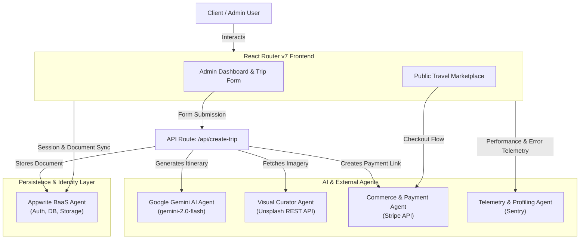

# System Agents & Autonomous Services

This document details the autonomous and specialized agents, AI models, and background services operating within the **Tourvisto / Travel Agency Platform**.

---

## 1. System Agent Architecture

The platform architecture integrates intelligent generative AI agents, third-party curation services, commerce pipelines, and backend data agents.

---

## 2. Agent Catalog & Responsibilities

### 🤖 Generative Travel Itinerary Agent (Google Gemini)
- **Engine**: Google Generative AI (`gemini-2.0-flash` via `@google/generative-ai`)
- **Primary Source File**: [app/routes/api/create-trip.ts](file:///C:/travel-agency-dashboard/app/routes/api/create-trip.ts#L19-L75)
- **Role**: Autonomous travel planning intelligence.
- **Inputs**:
  - `country`: Target travel destination
  - `numberOfDays`: Itinerary length (1 to 10 days)
  - `travelStyle`: Adventure, Relaxation, Cultural, etc.
  - `interests`: Food, Nature, History, Photography, etc.
  - `budget`: Budget, Moderate, Luxury
  - `groupType`: Solo, Couple, Family, Friends
- **Output**: Clean JSON schema structure featuring:
  - Descriptive trip title and 100-word summary
  - Lowest estimated trip price (USD)
  - 4-season "Best Time to Visit" analysis
  - Temperature & seasonal weather breakdown
  - Geocoded coordinates `[lat, lng]` and OpenStreetMap linkage
  - Structured daily itinerary with chronological activity time slots (Morning, Afternoon, Evening)

### 📸 Visual Curator Agent (Unsplash API)
- **Engine**: Unsplash Developer Search API
- **Primary Source File**: [app/routes/api/create-trip.ts](file:///C:/travel-agency-dashboard/app/routes/api/create-trip.ts#L76-L82)
- **Role**: Real-time contextual photography curator.
- **Workflow**:
  1. Receives combined keywords: `${country} ${interests} ${travelStyle}`.
  2. Queries Unsplash endpoint with API authorization.
  3. Filters and normalizes top three high-resolution image URLs.
  4. Delivers image bundle to database and payment product schemas.

### 💳 Commerce & Payment Gateway Agent (Stripe)
- **Engine**: Stripe API (`stripe` v18.0.0, API version `2025-03-31.basil`)
- **Primary Source File**: [app/lib/stripe.ts](file:///C:/travel-agency-dashboard/app/lib/stripe.ts#L17-L55)
- **Role**: Autonomous product creation and payment link generation.
- **Workflow**:
  1. Creates Stripe `Product` with trip title, description, and Unsplash imagery.
  2. Creates Stripe `Price` object in USD based on AI-estimated price (`Math.round(price * 100)`).
  3. Creates single-line-item `PaymentLink` with `metadata.tripId`.
  4. Configures completion redirection to `${VITE_BASE_URL}/travel/${tripId}`.
  5. Injects `payment_link` into the Appwrite document.

### 🛡️ Identity, State & Persistence Agent (Appwrite)
- **Engine**: Appwrite Cloud BaaS (`appwrite` v17.0.2)
- **Primary Source Files**:
  - [app/appwrite/client.ts](file:///C:/travel-agency-dashboard/app/appwrite/client.ts)
  - [app/appwrite/auth.ts](file:///C:/travel-agency-dashboard/app/appwrite/auth.ts)
  - [app/appwrite/dashboard.ts](file:///C:/travel-agency-dashboard/app/appwrite/dashboard.ts)
  - [app/appwrite/trips.ts](file:///C:/travel-agency-dashboard/app/appwrite/trips.ts)
- **Role**: Data integrity, session synchronization, and RBAC governance.
- **Responsibilities**:
  - Executes OAuth2 Google authentication sessions.
  - Queries Google People API (`people.googleapis.com`) to extract high-resolution profile avatars.
  - Persists and manages user profiles in the `userCollectionId`.
  - Performs aggregation queries for metrics: monthly signups, trip creation velocity, and travel style breakdowns.
  - Governs access permissions between public users (`status: 'user'`) and administrators.

### 📊 Observability & Telemetry Agent (Sentry)
- **Engine**: `@sentry/react-router` & `@sentry/profiling-node`
- **Primary Source Files**:
  - [instrument.server.mjs](file:///C:/travel-agency-dashboard/instrument.server.mjs)
  - [app/root.tsx](file:///C:/travel-agency-dashboard/app/root.tsx#L9)
- **Role**: Continuous performance monitoring and runtime error capture.
- **Responsibilities**:
  - Traces client and server route transitions.
  - Monitors Node server profiling in framework mode.
  - Captures uncaught exceptions with sourcemap resolution.

### 🛠️ Antigravity Developer & Refactoring Agent
- **Role**: Solo developer assistant & codebase orchestrator.
- **Actions Executed**:
  - Analyzed complete project architecture and dependency footprint.
  - Sanitized historical authorship metadata and rebuilt Git commit tree.
  - Rebranded application assets and user context to **Tushar Vashishtha**.
  - Generated comprehensive system architecture documentation.
