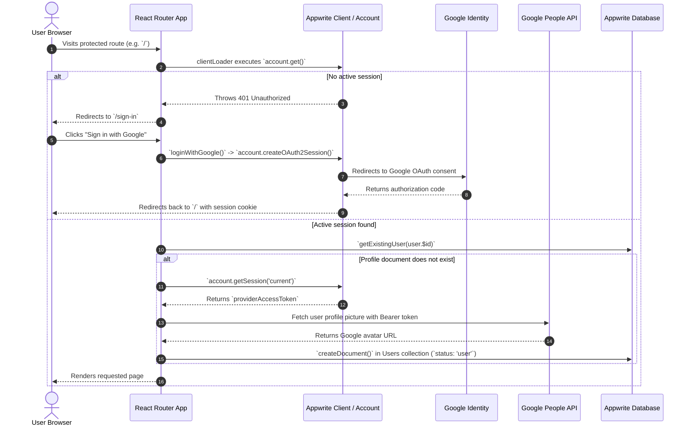
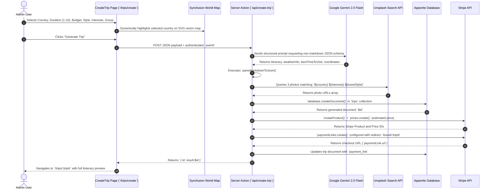
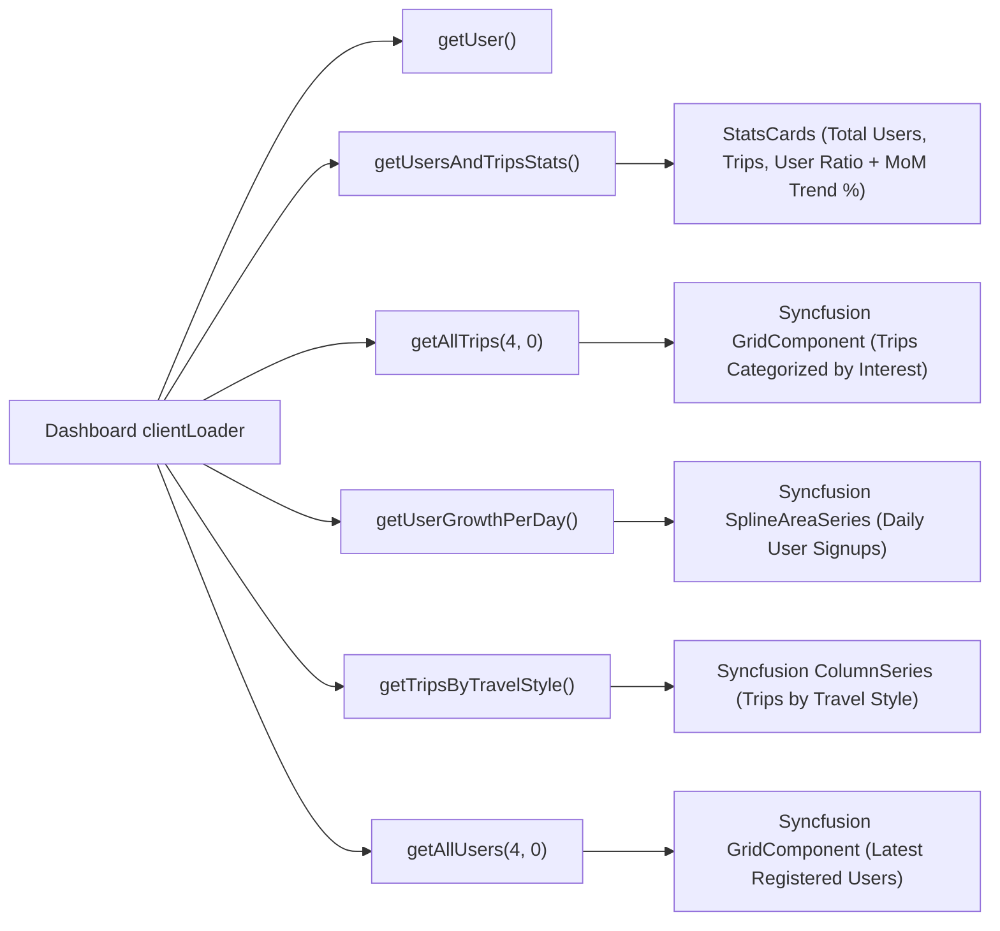

# Full Application Flow & Architecture

This document provides a comprehensive analysis of the application flow, data pipelines, and user journeys across the **Tourvisto / Travel Agency Platform**.

---

## 1. System Architecture Overview

The application is built on **React Router v7** in framework mode (full-stack SSR/SPA), powered by **Vite** and **Tailwind CSS**, integrated with **Appwrite** for Backend-as-a-Service, **Google Gemini 2.0 Flash** for AI itinerary generation, **Stripe** for payment processing, and **Syncfusion Essential JS 2** for high-performance dashboard charts and grids.

```mermaid
flowchart TD
    subgraph Client["Client Browser"]
        GuestUser["Guest / Public User"]
        AdminUser["Admin User"]
    end

    subgraph AppRouter["React Router v7 Framework"]
        RootRoute["Root Layout (app/root.tsx)"]
        PublicLayout["Public Layout (routes/root/page-layout.tsx)"]
        AdminLayout["Admin Layout (routes/admin/admin-layout.tsx)"]
        APIRoute["API Route (routes/api/create-trip.ts)"]
    end

    subgraph ExternalServices["External APIs & Services"]
        GoogleOAuth["Google OAuth2"]
        PeopleAPI["Google People API"]
        GeminiAI["Google Gemini 2.0 Flash"]
        UnsplashAPI["Unsplash REST API"]
        StripeAPI["Stripe Payment Platform"]
    end

    subgraph BaaS["Appwrite Backend"]
        AccountService["Appwrite Account / Auth"]
        DatabaseService["Appwrite Databases"]
        UserCollection[("Users Collection")]
        TripCollection[("Trips Collection")]
    end

    GuestUser -->|Views Public Trips & Details| PublicLayout
    AdminUser -->|Manages Trips & Analytics| AdminLayout
    AdminLayout -->|Triggers Generation| APIRoute

    PublicLayout -->|Auth Guard| AccountService
    AdminLayout -->|RBAC Guard (status !== 'user')| AccountService

    APIRoute -->|AI Prompting| GeminiAI
    APIRoute -->|Fetch Image URLs| UnsplashAPI
    APIRoute -->|Persist Trip| DatabaseService
    APIRoute -->|Generate Payment Link| StripeAPI

    AccountService -->|OAuth| GoogleOAuth
    AccountService -->|Avatar Fetch| PeopleAPI
    DatabaseService --- UserCollection
    DatabaseService --- TripCollection
```

---

## 2. Route Hierarchy

| Route Path | Type | Component File | Description | Access Control |
| :--- | :--- | :--- | :--- | :--- |
| `/sign-in` | Public | [app/routes/root/sign-in.tsx](file:///C:/travel-agency-dashboard/app/routes/root/sign-in.tsx) | Google OAuth entry screen | All (redirects to `/` if logged in) |
| `/` | Public | [app/routes/root/travel-page.tsx](file:///C:/travel-agency-dashboard/app/routes/root/travel-page.tsx) | Hero page, featured spots, paginated trip grid | Authenticated Users |
| `/travel/:tripId` | Public | [app/routes/root/travel-detail.tsx](file:///C:/travel-agency-dashboard/app/routes/root/travel-detail.tsx) | Detailed itinerary view, weather, gallery, buy button | Authenticated Users |
| `/travel/:tripId/success` | Public | [app/routes/root/payment-success.tsx](file:///C:/travel-agency-dashboard/app/routes/root/payment-success.tsx) | Payment celebration screen with confetti | Authenticated Users |
| `/api/create-trip` | Server Action | [app/routes/api/create-trip.ts](file:///C:/travel-agency-dashboard/app/routes/api/create-trip.ts) | Server-side AI trip generation endpoint | Admins via client action |
| `/dashboard` | Admin | [app/routes/admin/dashboard.tsx](file:///C:/travel-agency-dashboard/app/routes/admin/dashboard.tsx) | Analytics, growth charts, stats cards, recent signups | Admins only |
| `/all-users` | Admin | [app/routes/admin/all-users.tsx](file:///C:/travel-agency-dashboard/app/routes/admin/all-users.tsx) | Syncfusion grid of registered users | Admins only |
| `/trips` | Admin | [app/routes/admin/trips.tsx](file:///C:/travel-agency-dashboard/app/routes/admin/trips.tsx) | Admin management grid of all AI trips | Admins only |
| `/trips/create` | Admin | [app/routes/admin/create-trip.tsx](file:///C:/travel-agency-dashboard/app/routes/admin/create-trip.tsx) | Interactive trip creation form with live world map | Admins only |
| `/trips/:tripId` | Admin | [app/routes/admin/trip-detail.tsx](file:///C:/travel-agency-dashboard/app/routes/admin/trip-detail.tsx) | Admin view of single generated itinerary | Admins only |

---

## 3. End-to-End User Journeys

### Journey 1: Authentication & User Auto-Provisioning Flow



### Journey 2: Role-Based Access Control (RBAC) Flow

1. Every administrative route resides under `routes/admin/admin-layout.tsx`.
2. When any navigation occurs under `/dashboard`, `/all-users`, or `/trips/*`:
   - `clientLoader` in [app/routes/admin/admin-layout.tsx](file:///C:/travel-agency-dashboard/app/routes/admin/admin-layout.tsx#L7-L24) executes.
   - It fetches the active Appwrite account via `account.get()`. If unauthenticated, it redirects to `/sign-in`.
   - It fetches the corresponding profile document from `userCollectionId`.
   - **Role Check**: If `existingUser.status === 'user'`, the user is explicitly denied admin access and redirected back to public home `/`.
   - If the user has administrative rights, the layout mounts the desktop `SidebarComponent` and `MobileSidebar`.

---

### Journey 3: The AI Trip Generation Pipeline

This is the core functional engine of the platform, transforming administrative criteria into a fully bookable travel package.



---

### Journey 4: Public Discovery, Itinerary Inspection & Checkout

1. **Discovery (`/`)**:
   - The user browses featured destinations (ratings, activity count, hero cards).
   - Below the hero, `getAllTrips(limit: 8, offset)` fetches AI trips with pagination.
   - User navigates through pages using the Syncfusion `PagerComponent`.
2. **Inspection (`/travel/:tripId`)**:
   - The user selects a trip card.
   - The loader queries `getTripById(tripId)` and parses the raw JSON string into the typed `Trip` interface via [app/lib/utils.ts](file:///C:/travel-agency-dashboard/app/lib/utils.ts#L29-L38).
   - Displays:
     - Header pills with trip metadata: duration, destination list, tags, rating badge (4.9/5).
     - Responsive image gallery layout (1 main hero photo + 2 companion photos).
     - Day-by-day itinerary schedule breakdown with icons (Morning, Afternoon, Evening).
     - Seasonal weather tables and "Best Time to Visit" guidance.
     - Sticky CTA button with live estimated price pill: `"Pay to join the trip"`.
3. **Checkout Execution**:
   - Clicking the CTA links directly to `trip.payment_link` generated by Stripe.
   - The user completes payment securely on Stripe's hosted checkout.
   - Upon payment authorization, Stripe redirects the customer back to the platform URL.

---

### Journey 5: Post-Payment Celebration Flow

- Route: `/travel/:tripId/success` or completed redirect.
- [app/routes/root/payment-success.tsx](file:///C:/travel-agency-dashboard/app/routes/root/payment-success.tsx#L12-L16) automatically fires two celebration confetti bursts (`canvas-confetti`) using `LEFT_CONFETTI` and `RIGHT_CONFETTI` angle parameters.
- User is presented with verified confirmation and one-click access to `"View trip details"` or `"Return to homepage"`.

---

### Journey 6: Administrative Analytics & Monitoring Flow

On route `/dashboard`, five concurrent asynchronous queries execute via `Promise.all`:



- **Trend Computation**: [app/lib/utils.ts](file:///C:/travel-agency-dashboard/app/lib/utils.ts#L44-L67) computes Month-over-Month (MoM) delta percentages and tags metrics as `increment`, `decrement`, or `no change` with color-coded arrows.
